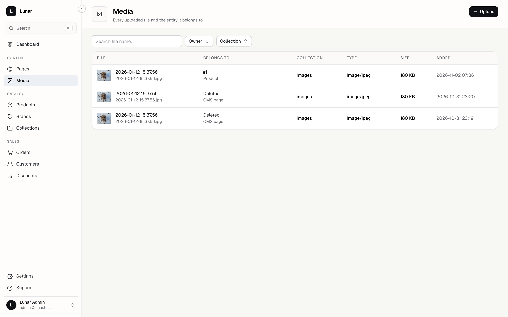
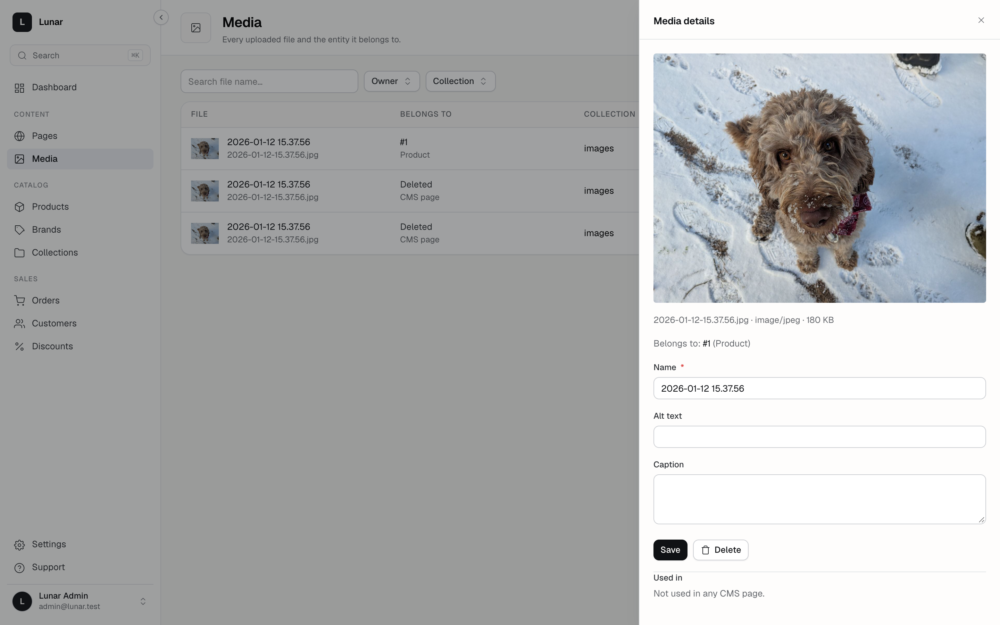
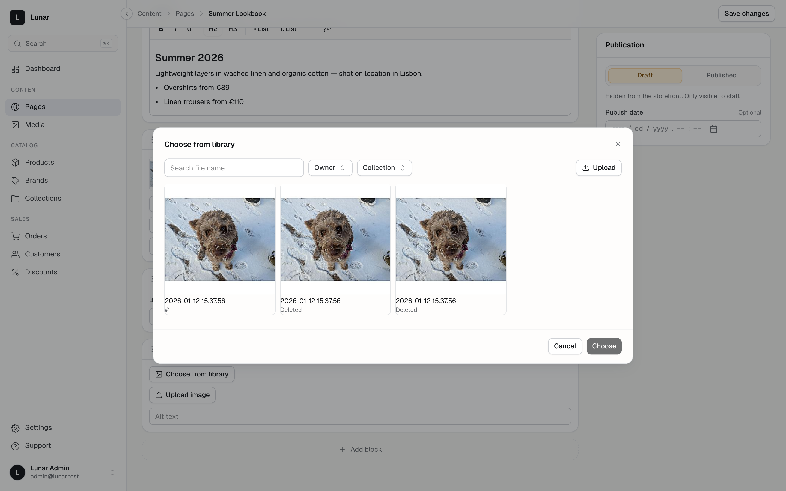

# Lunar Media add-on

Media library for the Lunar admin panel: a browsable, searchable asset library
plus a reusable picker that other add-ons and Lunar core sections can consume.
Built on `spatie/laravel-medialibrary` — uploads, conversions and storage are
all Media Library, this package adds the panel UI and the attach/usage layer.

## Screenshots

| Library | Asset details & usage | Picker (opened from a CMS block) |
|---|---|---|
|  |  |  |

## Installation

Requires PHP 8.3+, `lunarphp/panel` 2.x, and `spatie/laravel-medialibrary`
(already a Lunar core dependency). Add the repository — the package isn't on
Packagist yet:

```json
"repositories": [
    { "type": "vcs", "url": "https://github.com/fabianmarz/lunar-media" }
]
```

```bash
composer require lunar-2-test/media
php artisan migrate           # registers the media-manage permission
php artisan lunar:panel:link  # symlinks the compiled bundle into public/vendor/lunar-panel/media
```

`MediaServiceProvider` is auto-discovered — the library appears under
**Content → Media** in the panel nav. Install
[lunar-cms](https://github.com/fabianmarz/lunar-cms) alongside it if you want
the CMS `image` block's picker and CMS-page usage tracking (see Caveats).

## Development

Inside the monorepo-style app this package is developed in, it is wired via a
`path` composer repository (`packages/media`, namespace `LunarMedia\`):

```bash
cd packages/media
npm install        # once — deps externalize against panel globals
npm run build      # produces build/ (committed, linked via lunar:panel:link)
npm run dev        # vite build --watch while editing JS
```

## Features

| Area | Route / surface | Notes |
|------|-----------------|-------|
| Browse, search, filter | `GET /panel/media` | `MediaQuery` drives listing |
| Upload | `POST /panel/media` | `MediaUploadRequest` validation |
| Metadata edit | `PUT /panel/media/{media}` | alt text, custom properties |
| Delete | `DELETE /panel/media/{media}` | blocked while the file is in use |
| Usage listing | `GET /panel/media/{media}` | which owners reference the file |
| Attach to owner | `POST /panel/media/{media}/attach` | product / brand / collection |
| Picker | `GET /panel/media/picker` + `media::MediaPicker` component | consumed by other add-ons |

## Extension surfaces

### `media::MediaPicker` — cross-add-on component

`addon.ts` registers components eagerly so other bundles can resolve them at
runtime:

```ts
window.LunarPanel.registerComponents('media', {
    MediaPicker,
    AttachFromLibrary,
});
```

Consumers resolve it by name — this is how the CMS `image` block opens the
picker without importing the media bundle:

```ts
const MediaPicker = window.LunarPanel.resolveExtensionComponent?.('media::MediaPicker');
```

Always optional-chain the lookup: the media add-on is optional, and a hard
import would break consumers when it isn't installed.

### Panel slots — attach UI on product/brand/collection pages

`MediaSection::slots(SlotRegistry)` injects `AttachFromLibrary` into the core
catalog pages' media areas, wired to the `attach` endpoint. To render attach
UI on your own page, register a slot zone there and attach through the same
`POST /panel/media/{media}/attach` route (`MediaAttachRequest`).

## Caveats

- **Soft dependency on the CMS add-on.** `Support/OwnerResolver` and
  `Support/MediaUsage` resolve CMS `Page` models for usage reporting — usage
  tracking degrades gracefully, but treat the two add-ons as shipped together
  for now (guarding this properly is on the roadmap).
- **Shared compiled CSS** and **externalized deps** — same constraints as the
  CMS add-on: import panel components only from `@lunarphp/panel` (the `ui.ts`
  barrel), never bundle Vue/Inertia/vue-i18n, and don't rely on Tailwind
  utilities the panel's build didn't emit (see `packages/cms/README.md` for the
  full trap list).
